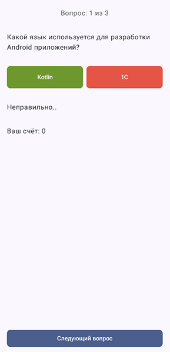

# Задание 2 - Практические задания по Jetpack Compose

### Задание и Результат работы

 

### Требования:
* Два варианта и результат
* При выборе правильного ответа начисляется балл
* После выбора показывается сообщение о результате
* Повторно ответить на тот же вопрос нельзя
* Кнопка "Следующий вопрос" переключает вопрос
* Всего три заранее заданных вопроса
